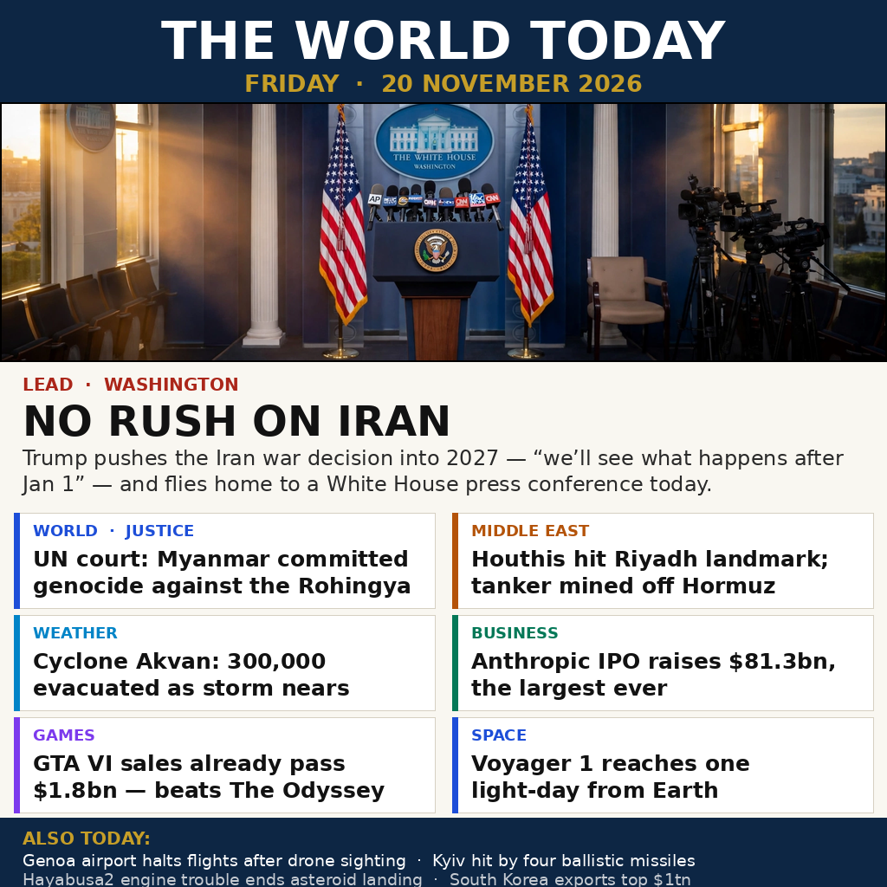

# makefun-news-image-20261120

[](https://make.fun/bounty/news-image-20261120?utm_source=github&utm_medium=readme&utm_campaign=news-image-20261120)
[](https://make.fun/bounty/news-image-20261120/leaderboard?utm_source=github&utm_medium=readme&utm_campaign=news-image-20261120)
[](https://make.fun/bounty/news-image-20261120?utm_source=github&utm_medium=readme&utm_campaign=news-image-20261120)

**THE WORLD TODAY — Friday 20 November 2026.** One image that sums up
the day's world news as a newspaper front page. The lead story is Trump
pushing the Iran war decision into 2027 — "we'll see what happens
after Jan 1" — and flying home to a White House press conference. Six
boxes carry the rest of the day: the UN court ruling that Myanmar
committed genocide against the Rohingya, Houthi strikes on a Riyadh
landmark and a tanker mined off the Strait of Hormuz, Cyclone Akvan
with 300,000 evacuated ahead of landfall in Odisha, Anthropic's
$81.3bn IPO (the largest ever), GTA VI sales already passing $1.8bn,
and Voyager 1 reaching one light-day from Earth. The footer adds the
Genoa airport drone shutdown, four ballistic missiles hitting Kyiv,
Hayabusa2's engine trouble ending its asteroid landing, and South
Korean exports topping $1tn for the first time.

## The image



`entry.png` is 1024×1024, 479,154 bytes. The lead photograph — the
White House briefing room at dusk, podium and flags waiting for the
press conference — was generated for this entry, and every word on the
page is drawn with DejaVu so the text stays sharp at any size. The
front page itself was drawn with Pillow from the generated photograph;
no part of it is a screenshot of another publication. Each story was
checked against the day's reporting (Reuters, BBC, The Times of
India, The Hindu, SimpleLife, 20 Nov 2026) before the page was
drawn. The six boxes, left to right, are the Myanmar verdict, the
Houthi/Gulf attacks, Cyclone Akvan, the Anthropic IPO, GTA VI sales,
and Voyager 1.

## Run it

```sh
mkdir -p out && MAKEFUN_OUTPUT_DIR=out python3 main.py
# writes out/entry.png — byte-identical on every run, no network
```

## Files

- `main.py` — the entrypoint: copies `entry.png` to `/output/entry.png`
- `entry.png` — the front page itself
- `LICENSE` — MIT
